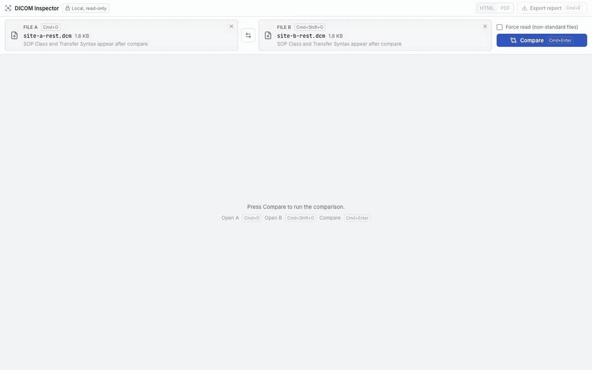
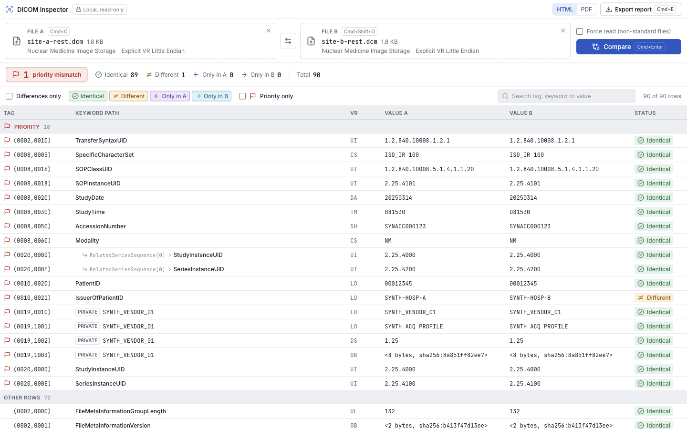
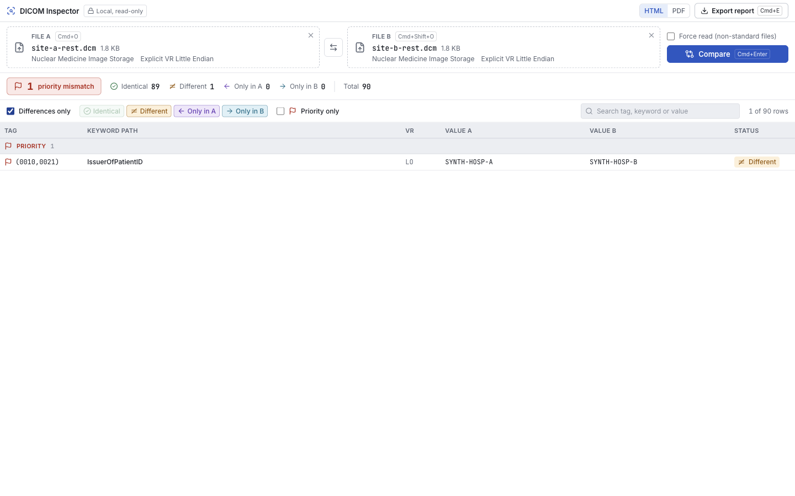
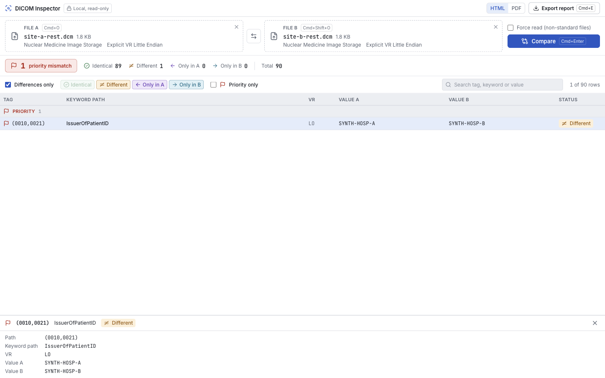
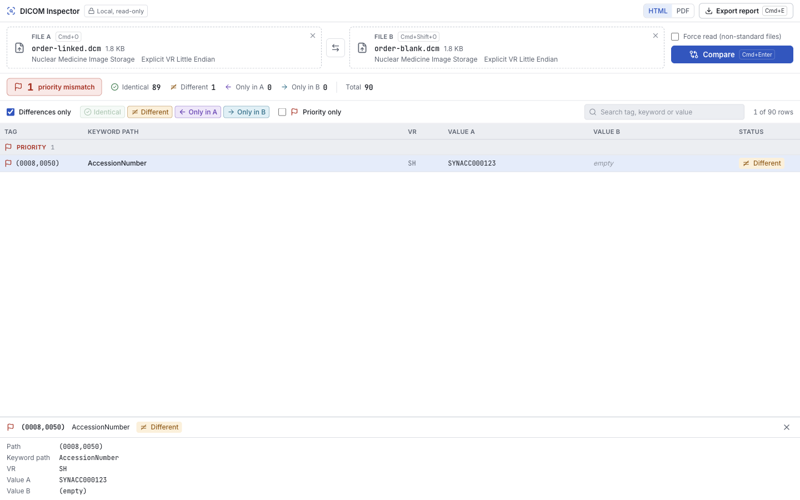
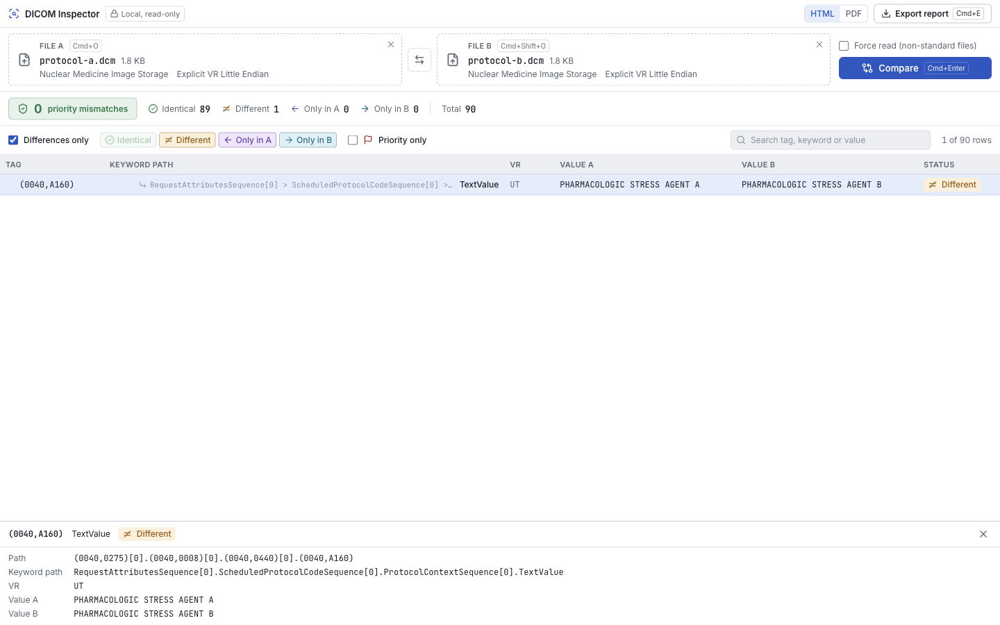
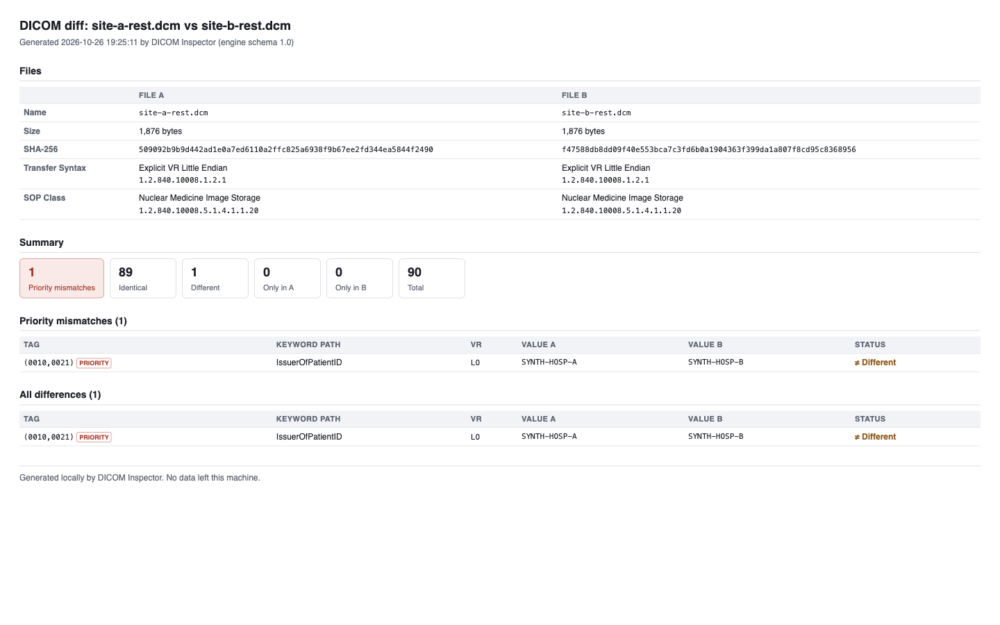
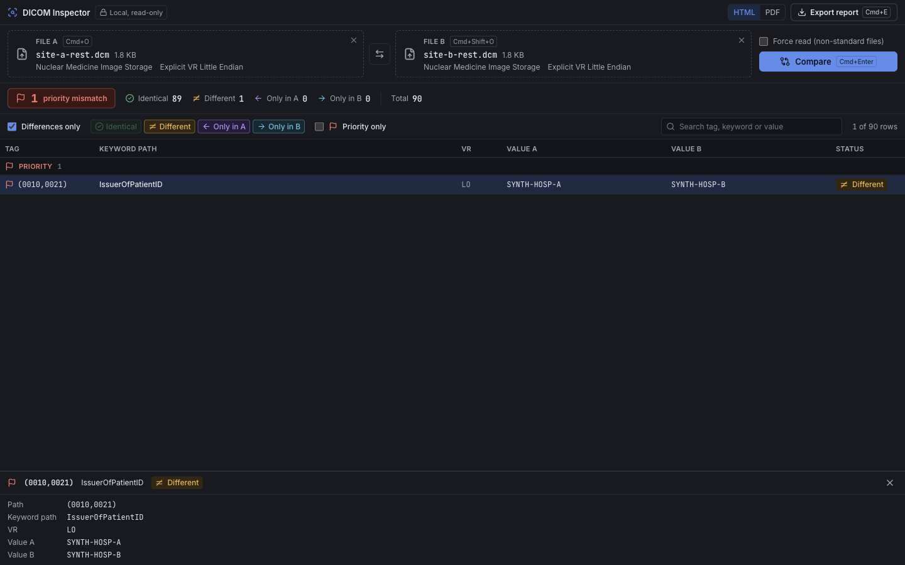

# DICOM Inspector

Compare the headers of two DICOM files and see the one difference that matters, fully offline.



## Why this exists

When two imaging systems disagree about the same study, the answer is usually
one header tag out of hundreds: an issuer, an accession number, a UID. Finding
it by hand means comparing tag dumps line by line. DICOM Inspector does the
comparison, puts the tags that break patient and order matching at the top,
and gives you a report you can attach to a ticket.

## Features

**Every tag, side by side.** File meta, the main dataset and every nested
sequence, flattened into one table with readable paths.



**The differences that matter, first.** "Differences only" cuts the table down
to what changed. Integration-critical tags (patient ID and issuer, accession
number, study, series and SOP UIDs, SOP Class, dates, character set, transfer
syntax) and all private tags are flagged as priority and pinned to the top.



**Full detail for any row.** Click a row to see its full path, VR and both values.



**Subtle cases made visible.** An empty value is shown as *empty*, not confused
with a missing tag. A value three sequences deep is shown with its full path.





**One-click reports.** Export a self-contained HTML report or a PDF: file
fingerprints (size, SHA-256, transfer syntax, SOP Class), summary counts,
priority mismatches first, then every difference.



**Built for daily use.** Light and dark themes follow the OS. Keyboard shortcuts
(Ctrl+O and Ctrl+Shift+O to open, Ctrl+Enter to compare, Ctrl+E to export;
Cmd on macOS), drag and drop, and a command line:
`"DICOM Inspector.exe" A.dcm B.dcm --compare`.



## Download and install

Windows 10 or 11 (x64). Download `DICOM-Inspector-Setup-0.1.0.exe` from this
repository's Releases page and run it. It installs for the current user by
default (no admin rights), with an option to install for all users. No Python or
other runtime is needed.

The installer is not code-signed yet, so Windows SmartScreen shows "Windows
protected your PC". Click **More info**, then **Run anyway**. If Windows blocks
the downloaded file, right-click it, choose **Properties**, tick **Unblock**
and click OK.

## Try it

[demo/pairs/](demo/pairs/) holds three pairs of synthetic files, each with one
planted mismatch: a different issuer for the same patient ID, a blank accession
number, and a difference three sequences deep. Drop `A.dcm` and `B.dcm` from a
folder onto File A and File B, then press Ctrl+Enter. Or, from the repository folder in PowerShell:

```powershell
& "$env:LOCALAPPDATA\Programs\DICOM Inspector\DICOM Inspector.exe" demo\pairs\01_issuer_mismatch\A.dcm demo\pairs\01_issuer_mismatch\B.dcm --compare
```

[demo/README.md](demo/README.md) explains what each pair shows, and
[docs/MISMATCH_CATALOG.md](docs/MISMATCH_CATALOG.md) lists all 20 test
scenarios with their real-world symptoms.

## How it works

```
React UI (Electron)  ->  local engine: Python + pydicom, run as a child process  ->  JSON diff  ->  table and report
```

The engine reads both files' headers, flattens them into one row per tag path,
and prints a versioned JSON diff. The UI shows it and renders reports. In the
installed app the engine is a frozen executable shipped next to the UI, so
nothing else needs to be installed. It is checked against 20 synthetic
mismatch scenarios with golden-file tests.

## Build from source

See [docs/BUILD.md](docs/BUILD.md): running from source, the test suites,
regenerating the demo media, and building the Windows installer with one command.

## Privacy

- **Read-only.** Files are opened for reading only and never modified.
- **Header-only.** Pixel data is never loaded.
- **No network.** No telemetry, crash reports or update checks. The app blocks
  every network request, and reports contain no external references.
- **Synthetic demo data.** Everything in this repository, including the
  screenshots and the GIF, uses invented patients, sites and devices.

Details: [docs/SECURITY.md](docs/SECURITY.md).

## License

[MIT](LICENSE). Third-party components and their licenses are listed in
`THIRD_PARTY_NOTICES.txt`, which is generated at build time and installed with
the app.
